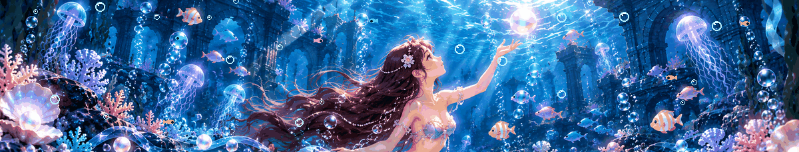
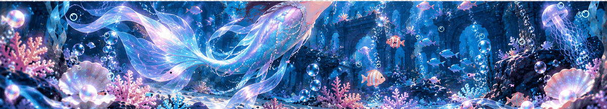

# 𝒮𝒶𝓎𝒶𝓁𝒾 𝒦𝓊𝓇𝒽𝑒

### 🌊 CSE (AI & DS) Student | Developer

*Exploring the ocean of technology, guided by curiosity.*

---

## 🫧 About Me

- 🎓 Computer Science Engineering student specializing in AI & Data Science.
- 💻 Interested in software development, machine learning, and data analytics.
- 🌱 Always learning, experimenting, and building new things.
- 🐚 Inspired by creativity, technology, and the mysteries of the ocean.

## 🐬 Tech Stack

---

## 🌊 GitHub Statistics

---

## 🧜‍♀️ Mermaid Ocean Adventure

## 🧜‍♀️ Mermaid Ocean Adventure

 

